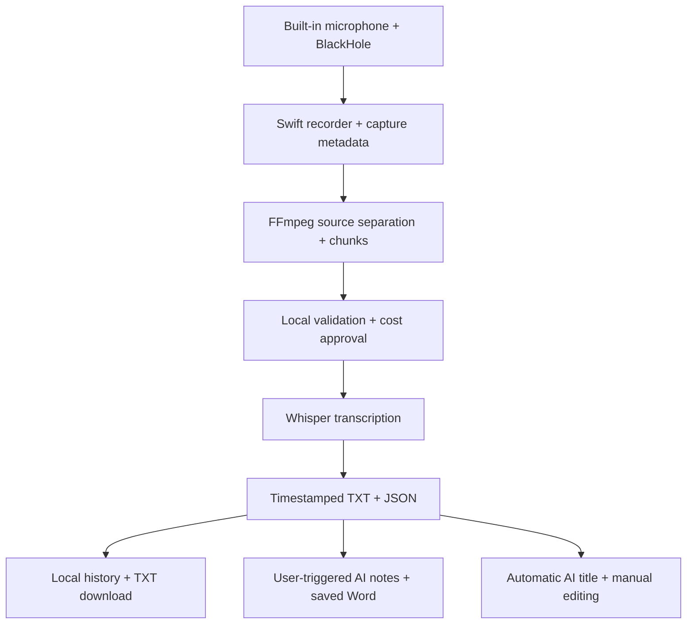

# Nilaris Transcription Agent

A local macOS app for recording microphone and system audio, transcribing it with
OpenAI Whisper, and browsing an editable transcript archive. Built by **Armin
Seyfi** as an applied AI engineering and AI consulting portfolio project.

Nilaris supports online meetings, classes, interviews, presentations and media
playback. A Flask interface runs on localhost. Selected audio is sent to OpenAI
only after transcription approval; completed untitled transcripts are sent as
text automatically to generate display titles. Manual titles are preserved. Clicking **Generate Meeting Notes with AI** sends
the transcript text to OpenAI without an additional cost confirmation.

## Working features

| Capability | Behavior |
| --- | --- |
| Microphone + system capture | Explicit CoreAudio device binding and verified per-recording channel metadata |
| Speaker/headphone routing | Temporary BlackHole + listening-device output; bounded speaker fallback after headphone disconnect, with marked silence for any recovery gap |
| Chunk preparation | Separate LOCAL/REMOTE streams; five-minute, mono 16 kHz, 64 kbps MP3 chunks |
| Paid transcription control | Cost estimate and explicit Whisper approval; silent chunks skipped and cached results reused |
| Timing | Chunk offsets retained; conservative boundary corrections with provenance in JSON |
| Transcript export | Raw transcript TXT download; JSON retained internally |
| Session archive | Monthly/yearly grouping, title/date search, inline title editing for any saved recording |
| AI notes | User-triggered notes in the dominant Persian, English or German language, saved as a Word document for repeated downloads |
| AI titles | One background GPT-4o mini request per untitled completed transcript; failed requests require manual retry |
| Data management | Audio-only cleanup preserves transcripts/titles; whole sessions move to macOS Trash |
| Audio download | On-demand MP3 of original session audio inside the collapsed Manage Session menu |

**LOCAL and REMOTE identify audio sources, not individual speakers.** Nilaris does
not currently perform participant diarization or join meetings
as a bot.

## Architecture



The Swift recorder owns audio binding, format checks and route recovery. Python
validates capture metadata, prepares chunks, controls transcription approval and
serves the archive. Transcript and title generation are separate: a title error
does not invalidate successful transcription.

## Run locally

Requirements: macOS, a Swift toolchain, Python with the packages in
`requirements.txt`, FFmpeg/ffprobe, BlackHole 2ch, and an OpenAI API key with access
to Whisper and `gpt-4o-mini`. This version has been tested on one development Mac;
other device combinations require validation.

```bash
git clone https://github.com/Armin-Seyfi/nilaris-transcription-agent.git
cd nilaris-transcription-agent
python3 -m venv .venv
source .venv/bin/activate
python -m pip install -r requirements.txt
cp .env.example .env
```

Set `OPENAI_API_KEY` in `.env`. Do not commit the key. Ensure FFmpeg and BlackHole
are installed. In Audio MIDI Setup, create an Aggregate Input named **Nilaris
Audio Input** containing BlackHole 2ch and the built-in microphone at 48 kHz. Keep
the meeting application's microphone set to a real microphone and its playback
set to system default. Nilaris resolves the aggregate channel order from device
metadata rather than assuming it.

```bash
./launch_nilaris.sh
```

The launcher uses `~/Library/Application Support/Nilaris` for persistent data and
opens `http://127.0.0.1:8765` in Google Chrome. Alternatively, run
`python src/web_server.py` and open that address in a browser; set `NILARIS_DATA_DIR`
to an external directory to keep development data outside the checkout.

Record, stop, prepare the recording, review the Whisper estimate and confirm.
The background worker then generates a title for an untitled completed transcript.
Use the pencil to edit any saved session title, including before transcription.
A manually assigned title is never automatically replaced.

Expand **Manage Session** and select **Download Session Audio (MP3)** to prepare
a local MP3 download. This works for old and new recordings, before or after
transcription, while the original CAF remains available. All recorded channels
are mixed equally into mono 44.1 kHz, 128 kbps audio, without trimming silence or
guessing historical speaker roles. The original stays untouched. Completed exports
are cached in the private data directory and reused while the source is unchanged.
Audio cleanup/full-session trash includes the cached export; already-downloaded
copies elsewhere on the computer remain under the user's control. If original
audio has been removed, the download button is disabled.

## AI meeting notes

Open **Meeting Transcript** to download the original TXT or select **Generate
Meeting Notes with AI**. There is no cost-confirmation dialog for notes. Generation
runs in the background. Once successful, the button becomes **Download
AI-Generated Notes (Word)**. Future downloads reuse the saved document without
another AI request; notes remain available after audio-only cleanup.

The dominant spoken language determines narrative language, localized headings,
and Word formatting: Persian uses RTL paragraphs and tables; English and German
use LTR. Legacy Persian Word documents are repaired locally on their next
download, retaining the prior file as a backup and making no AI request. Dates follow the existing Berlin recording metadata, with Jalali and
Gregorian dates for Persian. Notes are interpretive AI output; the original
transcript stays unchanged and should be consulted for consequential decisions.

Long transcripts are processed in complete contiguous parts, then synthesized;
no title-style sampling is used. Successful extraction steps and the final AI
response are checkpointed for explicit retries. Size limits fail clearly rather
than silently truncating content. Repeated clicks do not launch duplicate jobs.
Failures and interrupted jobs require an explicit retry and may have incurred API
costs; SDK retries are disabled. Storage deletion is blocked during generation,
and all notes/checkpoints live inside the session directory, so whole-session
Trash includes them. The prompt and structured output validation distinguish
proposals from decisions and leave unspecified owners or dates unassigned.

See [the system prompt](docs/meeting-notes-system-prompt.md). Tests use synthetic
transcripts and mocked AI responses; they verify workflow and formatting structure,
not the factual accuracy of a real model-generated summary.

## Reliability and evaluation

The recorder checks device composition, channel identity, incoming buffers and
actual CAF frames. It preserves partial recordings and reports failures instead
of accepting empty or mismapped captures. Temporary routing is restored on normal
shutdown and recoverable failures; a journal supports crash recovery.

Tests use synthetic files and mocked AI responses:

```bash
python -m unittest discover -s tests
```

These tests do not record audio or make paid API calls. Manual development checks
have covered speaker and stereo Bluetooth headphone capture. This is a personal
working MVP, not a claim of production readiness or universal hardware support.

Known limits:

- Device selection occurs when recording starts. Headphone connection/disconnection
  during recording may stop capture safely; seamless switching is not implemented.
- Playback outside recording follows macOS settings. Nilaris does not continuously
  manage the system output when idle.
- Apps using a fixed output may bypass system-default routing.
- Speaker leakage can reach the microphone; echo cancellation is not implemented.
- Timestamp repair is approximate, not forced word alignment.
- Historical raw recordings without verified mapping metadata are not guessed.
- Long-transcript titles use distributed excerpts and can miss a topic. Model
  access, account quotas and network failures can prevent AI title generation.

## Privacy and costs

Record only with appropriate participant consent. Whisper receives the approved
non-silent pending chunks; AI title generation receives transcript text or excerpts.
Automatic titles incur API charges without a separate per-title confirmation.
AI notes send the complete transcript text after a user click, without another
cost confirmation. Long recordings use multiple extraction calls plus synthesis.
Saved notes downloads are local and do not incur new API costs.
Requests are bounded and are not silently retried after failure. Manual editing
and archive search are local and free.

Credentials, recordings, transcript outputs, title sidecars, diagnostic previews
and local update backups are excluded from version control. The repository contains
source code, documentation and synthetic tests, not private sessions.

## Next steps

- Wider hardware and macOS compatibility testing
- Speaker diarization and echo handling
- Human evaluation of notes against meeting decisions and action items
- Evaluation against reference transcripts

Technical notes: [audio routing](docs/AUDIO_AUTOMATION.md),
[timestamp repair](docs/TIMESTAMP_REPAIR.md), [session titles](docs/SESSION_TITLES.md).

## Author

**Armin Seyfi** — AI Consulting · Business Strategy · AI Integration
